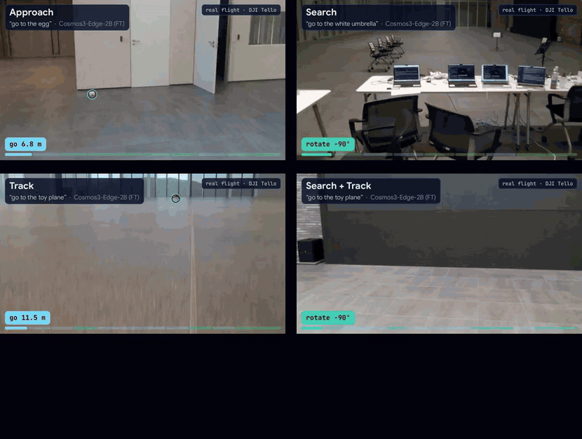
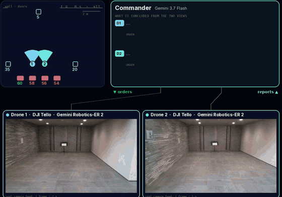
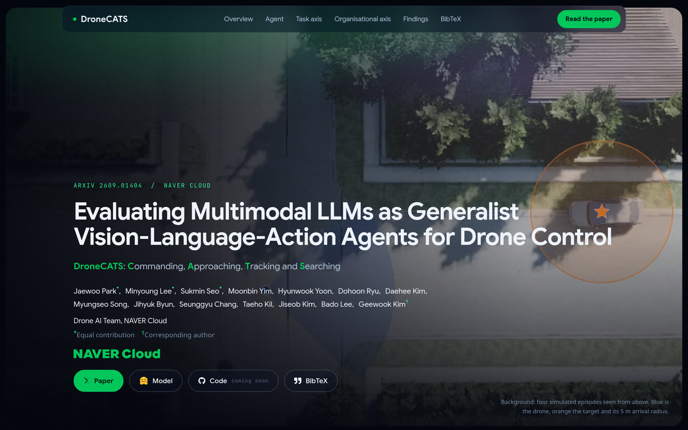

# DroneCATS

This is the official repository for the paper **"Evaluating Multimodal LLMs as Generalist Vision-Language-Action Agents for Drone Control: Commanding, Approaching, Tracking and Searching"**.

[](https://arxiv.org/abs/2609.01404)
[](https://naver-ai.github.io/DroneCATS/)
[](https://huggingface.co/naver-ai/DroneCATS-Cosmos3-Edge-2B)

[Jaewoo Park](https://www.linkedin.com/in/jaewoo-park-606538168/)\*, [Minyoung Lee](https://www.linkedin.com/in/minlee98/)\*, [Sukmin Seo](https://www.linkedin.com/in/%EC%84%9D%EB%AF%BC-%EC%84%9C-9ab911233/)\*, [Moonbin Yim](https://www.linkedin.com/in/moonbin-yim/), [Hyunwook Yoon](https://www.linkedin.com/in/hyunwook-yoon-303853171/), [Dohoon Ryu](https://www.linkedin.com/in/dh-ryu/), [Daehee Kim](https://www.linkedin.com/in/daehee-kim-40499b184/),
[Myungseo Song](https://micmic123.github.io/), [Jihyuk Byun](https://www.linkedin.com/in/jihyuk-byun/), [Seunggyu Chang](https://www.linkedin.com/in/seunggyu-chang-2758b4416/), [Taeho Kil](https://www.linkedin.com/in/taeho-kil/), [Jiseob Kim](https://www.linkedin.com/in/jiseob-kim-8a1b9634b/), [Bado Lee](https://www.linkedin.com/in/bado-lee-61177162/), [Geewook Kim](https://geewook.kim/)<sup>†</sup>

Drone AI Team, NAVER Cloud &nbsp;·&nbsp; \*Equal contribution &nbsp;·&nbsp; <sup>†</sup>Corresponding author

## News

- **2026.10.16** The paper is on [arXiv](https://arxiv.org/abs/2609.01404), the [project page](https://naver-ai.github.io/DroneCATS/) is live, and the fine-tuned 2B model is on [Hugging Face](https://huggingface.co/naver-ai/DroneCATS-Cosmos3-Edge-2B).

<table>
  <tr>
    <td width="50%"></td>
    <td width="50%"></td>
  </tr>
  <tr>
    <td><sub>One fine-tuned 2B model flies Approach, Search, Track and Search + Track on a real DJI Tello. Its 0.6 s step is faster than every frontier API we tested, and it outperformed the frontier models we flew.</sub></td>
    <td><sub>Commander + sub-agents on two real DJI Tellos: the commander reads both views and sends each drone its next order.</sub></td>
  </tr>
</table>

<p align="center">▶ <a href="https://naver-ai.github.io/DroneCATS/assets/videos/teaser.mp4">Watch the teaser video</a></p>

## Project Page

Replays, real-flight videos and all results are on the project page.

<p align="center">
  <a href="https://naver-ai.github.io/DroneCATS/"></a>
</p>

## Results

**Single drone.** Success rate (%). Simulation: 20 episodes per task, each flown twice. Real drone: mean over the four tasks, 5 episodes each.

| Model | Approach | Search | Track | Search + Track | Mean | Real drone |
|---|:-:|:-:|:-:|:-:|:-:|:-:|
| Gemini 3.7 Flash | **87.5** | **67.5** | 55 | 47.5 | **64.4** | 45 |
| Claude Opus 5 | 57.5 | 47.5 | 40 | 40 | 46.2 | 30 |
| Gemini Robotics-ER 2 | 62.5 | 47.5 | **70** | 50 | 57.5 | – |
| GPT-5 | 55 | 37.5 | 62.5 | **65** | 55 | – |
| Qwen3.5-27B | 60 | 45 | 25 | 27.5 | 39.4 | – |
| Qwen3.5-9B | 32.5 | 15 | 32.5 | 5 | 21.2 | 10 |
| Qwen3.5-4B | 12.5 | 5 | 7.5 | 0 | 6.2 | – |
| Qwen3.5-2B | 0 | 0 | 0 | 0 | 0 | – |
| Cosmos3-Edge-2B | 0 | 0 | 0 | 0 | 0 | 0 |
| **Cosmos3-Edge-2B (FT, ours)** | 35 | 35 | 27.5 | 27.5 | 31.2 | **55** |

**Four drones.** Success rate (%) over 30 episodes per model, with one model driving all four drones vs. the same model commanding four sub-agents.

| Model | One model drives all four | Commander + sub-agents |
|---|:-:|:-:|
| Gemini 3.7 Flash | 50.0 | **93.3** |
| Claude Opus 5 | 46.7 | 86.7 |
| Gemini Robotics-ER 2 | 53.3 | 76.7 |
| GPT-5 | 13.3 | 60.0 |
| Qwen3.5-27B | 26.7 | 53.3 |
| Qwen3.5-9B | 36.7 | 43.3 |
| Qwen3.5-4B | 16.7 | 43.3 |
| Qwen3.5-2B | 3.3 | 50.0 |
| Cosmos3-Edge-2B | 0.0 | 33.3 |

## Model

The fine-tuned 2B model is available on Hugging Face: [naver-ai/DroneCATS-Cosmos3-Edge-2B](https://huggingface.co/naver-ai/DroneCATS-Cosmos3-Edge-2B). It loads with 🤗 Transformers, and the model card shows how to use it.

## Release Plan

- [x] Fine-tuned 2B model
- [ ] Benchmark
- [ ] Code

The benchmark and the code will be released soon. Stay tuned for updates!

## Citation

```bibtex
@article{park2026dronecats,
  title   = {Evaluating Multimodal LLMs as Generalist Vision-Language-Action Agents
             for Drone Control: Commanding, Approaching, Tracking and Searching},
  author  = {Park, Jaewoo and Lee, Minyoung and Seo, Sukmin and Yim, Moonbin and
             Yoon, Hyunwook and Ryu, Dohoon and Kim, Daehee and Song, Myungseo and
             Byun, Jihyuk and Chang, Seunggyu and Kil, Taeho and Kim, Jiseob and
             Lee, Bado and Kim, Geewook},
  journal = {arXiv preprint arXiv:2609.01404},
  year    = {2026}
}
```
