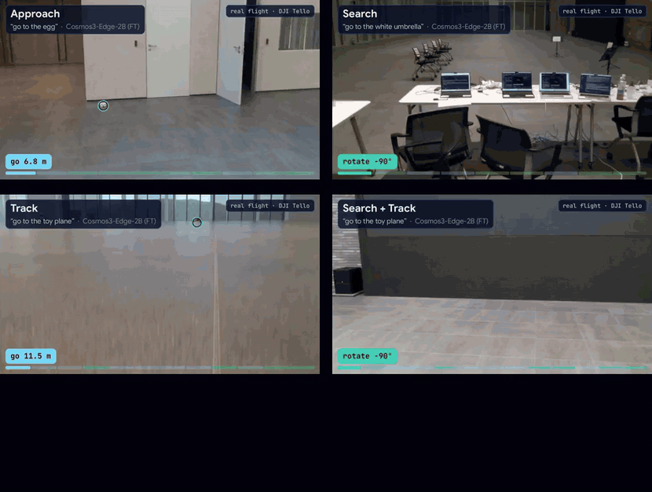
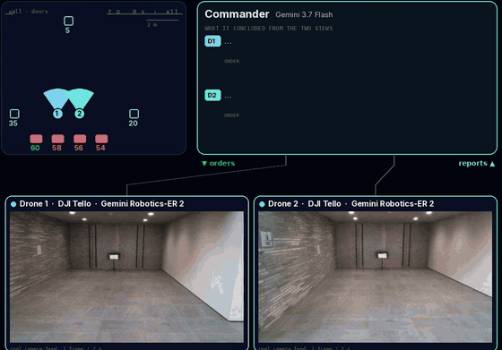
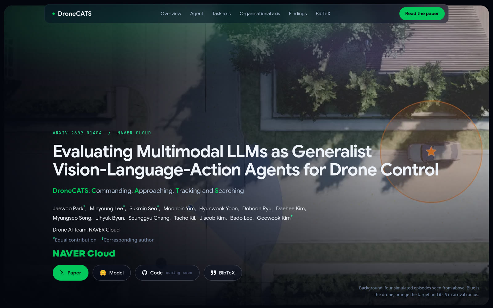

# DroneCATS

This is the official repository for the paper **"Evaluating Multimodal LLMs as Generalist Vision-Language-Action Agents for Drone Control: Commanding, Approaching, Tracking and Searching"**.

[](https://arxiv.org/abs/2609.01404)
[](https://naver-ai.github.io/DroneCATS/)
[](https://huggingface.co/naver-ai/DroneCATS-Cosmos3-Edge-2B)

[Jaewoo Park](https://www.linkedin.com/in/jaewoo-park-606538168/)\*, [Minyoung Lee](https://www.linkedin.com/in/minlee98/)\*, [Sukmin Seo](https://www.linkedin.com/in/%EC%84%9D%EB%AF%BC-%EC%84%9C-9ab911233/)\*, [Moonbin Yim](https://www.linkedin.com/in/moonbin-yim/), [Hyunwook Yoon](https://www.linkedin.com/in/hyunwook-yoon-303853171/), [Dohoon Ryu](https://www.linkedin.com/in/dh-ryu/), [Daehee Kim](https://www.linkedin.com/in/daehee-kim-40499b184/),
[Myungseo Song](https://micmic123.github.io/), [Jihyuk Byun](https://www.linkedin.com/in/jihyuk-byun/), [Seunggyu Chang](https://www.linkedin.com/in/seunggyu-chang-2758b4416/), [Taeho Kil](https://www.linkedin.com/in/taeho-kil/), [Jiseob Kim](https://www.linkedin.com/in/jiseob-kim-8a1b9634b/), [Bado Lee](https://www.linkedin.com/in/bado-lee-61177162/), [Geewook Kim](https://geewook.kim/)<sup>†</sup>

Drone AI Team, NAVER Cloud &nbsp;·&nbsp; \*Equal contribution &nbsp;·&nbsp; <sup>†</sup>Corresponding author

## News

- **2026.11.20** The benchmark and the code are released in this repository.
- **2026.10.16** The paper is on [arXiv](https://arxiv.org/abs/2609.01404), the [project page](https://naver-ai.github.io/DroneCATS/) is live, and the fine-tuned 2B model is on [Hugging Face](https://huggingface.co/naver-ai/DroneCATS-Cosmos3-Edge-2B).

<table>
  <tr>
    <td width="50%"></td>
    <td width="50%"></td>
  </tr>
  <tr>
    <td><sub>One fine-tuned 2B model flies Approach, Search, Track and Search + Track on a real DJI Tello. Its 0.6 s step is faster than every frontier API we tested, and it outperformed the frontier models we flew.</sub></td>
    <td><sub>Commander + sub-agents on two real DJI Tellos: the commander reads both views and sends each drone its next order.</sub></td>
  </tr>
</table>

<p align="center">▶ <a href="https://naver-ai.github.io/DroneCATS/assets/videos/teaser.mp4">Watch the teaser video</a></p>

## Project Page

Replays, real-flight videos and all results are on the project page.

<p align="center">
  <a href="https://naver-ai.github.io/DroneCATS/"></a>
</p>

## Results

**Single drone.** Success rate (%). Simulation: 20 episodes per task, each flown twice. Real drone: mean over the four tasks, 5 episodes each.

| Model | Approach | Search | Track | Search + Track | Mean | Real drone |
|---|:-:|:-:|:-:|:-:|:-:|:-:|
| Gemini 3.7 Flash | **87.5** | **67.5** | 55 | 47.5 | **64.4** | 45 |
| Claude Opus 5 | 57.5 | 47.5 | 40 | 40 | 46.2 | 30 |
| Gemini Robotics-ER 2 | 62.5 | 47.5 | **70** | 50 | 57.5 | – |
| GPT-5 | 55 | 37.5 | 62.5 | **65** | 55 | – |
| Qwen3.5-27B | 60 | 45 | 25 | 27.5 | 39.4 | – |
| Qwen3.5-9B | 32.5 | 15 | 32.5 | 5 | 21.2 | 10 |
| Qwen3.5-4B | 12.5 | 5 | 7.5 | 0 | 6.2 | – |
| Qwen3.5-2B | 0 | 0 | 0 | 0 | 0 | – |
| Cosmos3-Edge-2B | 0 | 0 | 0 | 0 | 0 | 0 |
| **Cosmos3-Edge-2B (FT, ours)** | 35 | 35 | 27.5 | 27.5 | 31.2 | **55** |

**Four drones.** Success rate (%) over 30 episodes per model, with one model driving all four drones vs. the same model commanding four sub-agents.

| Model | One model drives all four | Commander + sub-agents |
|---|:-:|:-:|
| Gemini 3.7 Flash | 50.0 | **93.3** |
| Claude Opus 5 | 46.7 | 86.7 |
| Gemini Robotics-ER 2 | 53.3 | 76.7 |
| GPT-5 | 13.3 | 60.0 |
| Qwen3.5-27B | 26.7 | 53.3 |
| Qwen3.5-9B | 36.7 | 43.3 |
| Qwen3.5-4B | 16.7 | 43.3 |
| Qwen3.5-2B | 3.3 | 50.0 |
| Cosmos3-Edge-2B | 0.0 | 33.3 |

## Model

The fine-tuned 2B model is available on Hugging Face: [naver-ai/DroneCATS-Cosmos3-Edge-2B](https://huggingface.co/naver-ai/DroneCATS-Cosmos3-Edge-2B). It loads with 🤗 Transformers, and the model card shows how to use it.

## Benchmark

A closed-loop benchmark for vision-language models that fly drones in simulation.
A model sees the drone's camera, picks an action (go to a point, rotate, think, declare arrival), and is judged on whether it actually reaches the target within a time limit.

- **Single drone** — four tasks (approaching, searching, tracking, search & track) on two maps (residential *NH* and *campus*), 10 episodes each.
- **Multi-drone** — four drones, three difficulty levels (license-plate matching, sign matching, three-sign sum), either one model driving all four drones or a commander model directing four sub-agents.

Simulation runs on [AirSim](https://github.com/microsoft/AirSim) (Unreal Engine 4) with its public v1.8.1 environment binaries.

- **Isaac Sim (outdoor)** — 28 episodes in NVIDIA's Brownstone scene on Isaac Sim 5.1 + Pegasus + PX4 SITL, with static, vehicle and pedestrian targets. See [`scripts/runpod/isaacsim/README.md`](scripts/runpod/isaacsim/README.md).
  On driver 595 hosts (most RunPod RTX 4090 Secure Cloud hosts) Isaac Sim 5.1 crashes on start; use Isaac Sim 6.0.1 there (`ISAAC_VERSION=6.0.1`).

## Layout

| Path | What |
|---|---|
| `episodes/airsim/` | AirSim benchmark episodes: `single-drone/`, `multi-drone/` (start poses, targets, prompts) |
| `episodes/isaacsim/` | Isaac Sim episodes: `single-drone/` (28 episodes, scene-batch target lists, two reference runs) |
| `vlmpilot/` | The pilot: camera → VLM → action → vehicle (`policy/` decision code; `controller/{airsim,isaacsim,real}/` vehicle control and mission loops). Model configs in `vlmpilot/configs/{airsim,isaacsim,real}/` (`airsim/`: `single-drone/`, `multi-drone/`, `multi-drone-with-subagents/`; `isaacsim/`: `single-drone/`; `real/`: the Tello). Tello setup tools in `vlmpilot/tools/tello/` |
| `verifier/` | Episode runners and judges: `airsim/` (`run_testset.py` single drone, `run_bench_tasks.py` multi-drone), `isaacsim/` (`batch_run.py` runner, `judge_run.py` judge) |
| `scripts/` | `airsim/`: launch / reset / spectate a simulator; `isaacsim/`: Pegasus launcher and setup, and the Isaac Sim scene, targets and ground truth (`isaacsim/sim/`); `runpod/airsim/`, `runpod/isaacsim/`: one-GPU cloud setups |
| `serving/` | vLLM server for DroneCATS-Cosmos3-Edge-2B (OpenAI-compatible API for `MODEL=dronecats-2b`; [`serving/README.md`](serving/README.md)) |
| `datagen/` | Rebuilds the depth instruction dataset (depth questions and drone actions) from the public source datasets and our annotation package ([`datagen/README.md`](datagen/README.md)) |

## Quick start (one cloud GPU)

The easiest path is one RunPod RTX 4090 pod — see [`scripts/runpod/airsim/README.md`](scripts/runpod/airsim/README.md).
In short:

```bash
git clone https://github.com/naver-ai/DroneCATS.git /workspace/DroneCATS && cd /workspace/DroneCATS
bash scripts/runpod/airsim/setup.sh                       # deps, maps, Python env, smoke test (~6 min the first time)
export OPENROUTER_API_KEY=...                       # your own key; never commit it
MODEL=gpt6-luna-or PARTS=single bash scripts/runpod/airsim/run_all.sh     # 80 single-drone episodes, ~55 min
python3 scripts/runpod/airsim/summarize.py /workspace/results/<run>
```

## Supported models

`MODELS=` names for single-drone runs (see `verifier/airsim/run_testset.py`); multi-drone runs take a config path.

| Model | Single | Multi-drone (one model) | Commander + Robotics-ER sub-agents |
|---|---|---|---|
| GPT-6 Luna (OpenRouter) | `gpt6-luna-or` | `configs/airsim/multi-drone/airsim_multi_gpt6luna_or.yaml` | `configs/airsim/multi-drone-with-subagents/airsim_agents_hluna_robotics_low_h40.yaml` |
| Gemini 3.8 Flash (OpenRouter) | `gemini38` | `configs/airsim/multi-drone/airsim_multi_gemini38_or.yaml` | `configs/airsim/multi-drone-with-subagents/airsim_agents_hg38f_robotics_h40.yaml` |
| Gemini 3.7 Flash (Google API) | `gemini37` | `configs/airsim/multi-drone/airsim_multi_gemini37flash.yaml` | `configs/airsim/multi-drone-with-subagents/airsim_agents_g37h_robotics_think_h40.yaml` |
| Claude Opus 5 (OpenRouter) | `claude` | `configs/airsim/multi-drone/airsim_multi_claude.yaml` | `configs/airsim/multi-drone-with-subagents/airsim_agents_hopus5_robotics_low_h40.yaml` |
| Qwen3.5-9B / 27B (OpenRouter) | `qwen35-9b` / `qwen35-27b` | `configs/airsim/multi-drone/airsim_multi_qwen35_*.yaml` | `configs/airsim/multi-drone-with-subagents/airsim_agents_hq*_robotics*.yaml` |
| DroneCATS-Cosmos3-Edge-2B (local server) | `dronecats-2b` | – | – |

DroneCATS-Cosmos3-Edge-2B is a single-drone pilot. It is not a model for driving several drones or for the commander role.

## Real drone (DJI Tello)

The same pilot flies a real DJI Tello (`vlmpilot/src/vlmpilot/controller/real/`). You need a Tello, a laptop joined to the Tello's Wi-Fi plus a second connection to the internet for the model API, and `OPENROUTER_API_KEY`.
The default config is `vlmpilot/configs/real/tello_gemini38_or.yaml` (Gemini 3.8 Flash via OpenRouter); it holds the camera calibration of our drones.

```bash
cd vlmpilot && uv sync --extra tello
uv run python -m vlmpilot tello      # asks for the instruction, then takes off
```

`vlmpilot/tools/tello/` has the setup tools: `tello_video_check.py` (video stream check, no takeoff), `tello_calib_capture.py` + `tello_calib_solve.py` (camera FOV and principal point from a printed checkerboard, `tello_chessboard_9x6_25mm_A4.pdf`), `tello_pitch_facing.py` / `tello_camera_tilt.py` (camera tilt) and `tello_teleop.py` (keyboard flight, needs `pygame`). Put the measured values into the config.

## API keys

Keys are read from environment variables only — `OPENROUTER_API_KEY`, `GEMINI_API_KEY`, `OPENAI_DIRECT_API_KEY`, and `OPENAI_API_KEY` for the few configs that name it (see `.env.example`).
Do not write keys into the repository or onto shared or persistent storage. On RunPod, store them as RunPod Secrets and reference them from the pod's environment variables.

## Cost

Measured on one RTX 4090 at $0.89/h. All figures are approximate. Pod time is about the same for every model:

| Part | Episodes | Simulators | Time | Pod |
|---|---|---|---|---|
| Single drone | 80 | 10 | 55 min | $0.8 |
| Multi-drone, the model drives all four | 30 | 6 | 35–40 min | $0.6 |
| Multi-drone, commander + four sub-agents | 30 | 6 | 35–40 min | $0.6 |
| Whole `run_all.sh` | 140 | | 2.2 h | $2.0 |

A multi-drone simulator renders four cameras, so it loads the GPU about as much as two single-drone simulators; 6 of them is close to the 10–12 single-drone simulators an RTX 4090 holds.

API cost is billed separately by each provider and depends on the model; check the provider's usage page after a run. The one large item is the Robotics-ER sub-agents (Google): $15–43 per 30 episodes in our runs, depending on the commander. `PARTS="single multi_self"` skips the commander part; the same-model variant needs only the OpenRouter key (see `scripts/runpod/airsim/README.md`).

## License

The code is licensed under the Apache License 2.0. The annotation data of `datagen/` is licensed separately under
CC BY-NC 4.0 (see `datagen/LICENSES/ANNOTATIONS.md`). AirSim, Isaac Sim and their environment binaries and assets are
distributed under their own licenses — see `NOTICE`.

## Citation

```bibtex
@article{park2026dronecats,
  title   = {Evaluating Multimodal LLMs as Generalist Vision-Language-Action Agents
             for Drone Control: Commanding, Approaching, Tracking and Searching},
  author  = {Park, Jaewoo and Lee, Minyoung and Seo, Sukmin and Yim, Moonbin and
             Yoon, Hyunwook and Ryu, Dohoon and Kim, Daehee and Song, Myungseo and
             Byun, Jihyuk and Chang, Seunggyu and Kil, Taeho and Kim, Jiseob and
             Lee, Bado and Kim, Geewook},
  journal = {arXiv preprint arXiv:2609.01404},
  year    = {2026}
}
```
